# Practical Assignment 4: Configuring and Testing a Web Application Firewall
---

## Contents

1. [Introduction and objectives](#1-introduction-and-objectives)
2. [Background](#2-background)
3. [Lab architecture](#3-lab-architecture)
4. [The vulnerable target application](#4-the-vulnerable-target-application)
5. [WAF configuration](#5-waf-configuration)
6. [Testing methodology](#6-testing-methodology)
7. [Results](#7-results)
8. [Analysis: how effective was the WAF?](#8-analysis-how-effective-was-the-waf)
9. [Problems encountered and how they were solved](#9-problems-encountered-and-how-they-were-solved)
10. [Limitations and recommendations](#10-limitations-and-recommendations)
11. [Conclusion](#11-conclusion)
12. [How to reproduce](#12-how-to-reproduce)
13. [References](#13-references)

---

## 1. Introduction and objectives

A Web Application Firewall (WAF) is a reverse proxy that inspects HTTP traffic and blocks requests (or
responses) that look like attacks before they reach the application. The module descriptor lists WAFs
under *2.7.4 Preventive measures against server-side attacks*.

The aims of this practical were to:

1. **Build** a deliberately vulnerable web application with the server-side flaws from Unit II
   (SQL injection, directory traversal, file upload, information disclosure, command injection,
   authentication/brute force), plus SSRF from Unit III.
2. **Configure** an industry-standard open-source WAF (ModSecurity v3 with the OWASP Core Rule Set)
   in front of it, then extend it with custom rules for this application.
3. **Test** the WAF with real attacks *and* legitimate traffic, comparing the unprotected app,
   the WAF with default rules, and the WAF with custom rules.
4. **Assess** how effective the WAF is, what it cannot do, and what should be done in addition
   (learning outcome 5).

## 2. Background

### 2.1 ModSecurity and the OWASP Core Rule Set

- **ModSecurity v3 (libmodsecurity)** is a WAF engine. It runs inside nginx through the
  ModSecurity-nginx connector and evaluates rules written in the *SecRule* language.
- **The OWASP Core Rule Set (CRS)** is a generic set of attack-detection rules for that engine.
  It covers SQLi, XSS, RCE, LFI/RFI, PHP/Java injection, protocol violations, scanners and data leakage.

### 2.2 How a request is evaluated

ModSecurity processes every transaction in five **phases**:

| Phase | Name | What can be inspected |
|-------|------|-----------------------|
| 1 | Request headers | URL, method, headers, client IP |
| 2 | Request body | Form fields, JSON, uploaded files |
| 3 | Response headers | Status code, response headers |
| 4 | Response body | The HTML/text returned by the application |
| 5 | Logging | Always runs; writes the audit log |

CRS uses **anomaly scoring**. Each rule that matches adds points (critical = 5, error = 4,
warning = 3, notice = 2). At the end of phase 2, rule **949110** blocks the request if the total
reaches the *inbound threshold* (default 5). Rule **959100** does the same for responses (default 4).
A single critical match therefore blocks, while weak signals can add up.

**Paranoia levels (PL1–PL4)** switch on progressively stricter rules. Higher levels catch more
attacks but also block more legitimate traffic (false positives).

### 2.3 Negative vs positive security model

| Model | Idea | Example in this project |
|-------|------|-------------------------|
| **Negative** (blocklist) | Block what *looks like* an attack | CRS signatures for `UNION SELECT`, `../`, `<script>` |
| **Positive** (allowlist) | Allow *only* what is valid and block everything else | "`host` must be a hostname or IPv4 address" |

CRS is a negative model. The custom rules in this project add a positive model for the
application's own parameters. This is known as **virtual patching**: the WAF fixes a known
vulnerability at the edge until the code is fixed.

## 3. Lab architecture

```
                 ┌───────────────────────────────────────────────┐
  attacker /     │  waf  (Docker)                                │        ┌───────────────────────┐
  browser ──────►│  nginx 1.30.6 + ModSecurity v3.0.17           │───────►│  app  (Docker)        │
  :8080          │  + OWASP CRS 4.30.0 + custom rules            │        │  VulnShop (Flask)     │
                 │  audit log → waf/logs/audit.log               │        │  SQLite, port 5000    │
                 └───────────────────────────────────────────────┘        └───────────────────────┘
  :5001  ─────────────────────────── direct, UNPROTECTED (baseline) ─────────────────►
```

| Component | Version | Source |
|-----------|---------|--------|
| WAF image | `owasp/modsecurity-crs:nginx-alpine`, pinned by digest | Official CRS Docker image |
| nginx | 1.30.6 | |
| libmodsecurity / connector | 3.0.17 / ModSecurity-nginx 1.0.4 | |
| OWASP CRS | 4.30.0 (856 rules + 21 custom = 877 loaded) | |
| Target app | Python 3.12, Flask 3.1.2, SQLite | `app/` |
| Orchestration | Docker Compose | `docker-compose.yml` |

Both ports are bound to **127.0.0.1 only**, because the application is intentionally exploitable
(command injection gives a root shell inside its container).

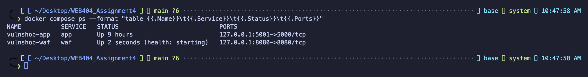
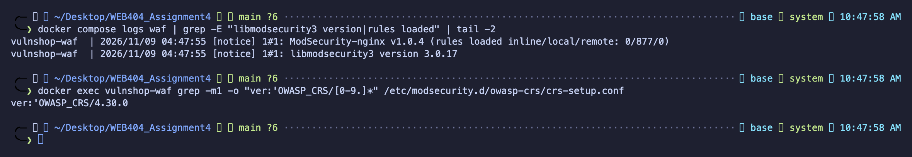

**Project structure**

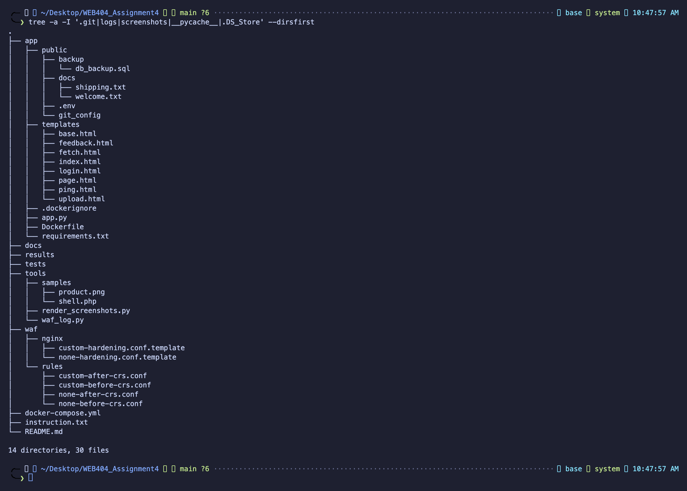

| Path | Purpose |
|------|---------|
| `app/` | Vulnerable Flask application (VulnShop) |
| `waf/rules/custom-before-crs.conf` | Custom request rules, loaded *before* CRS |
| `waf/rules/custom-after-crs.conf` | Custom response rules, loaded *after* CRS |
| `waf/rules/none-*.conf` | Empty files used for the "CRS only" baseline |
| `waf/nginx/custom-hardening.conf.template` | nginx header and error-page hardening |
| `tools/render_screenshots.py` | Runs each test command and renders the evidence screenshots |
| `tools/waf_log.py` | Readable view of the ModSecurity JSON audit log (rule IDs per request) |
| `tools/samples/` | Upload test files (`shell.php` test script, real `product.png`) |
| `screenshots/` | Evidence used in this report |

## 4. The vulnerable target application

**VulnShop** ([app/app.py](app/app.py)) is a small online shop. Every feature contains a classic
server-side flaw, mapped below to the module descriptor:

| Endpoint | Vulnerability | Root cause in code | Descriptor |
|----------|---------------|--------------------|------------|
| `POST /login` | SQLi authentication bypass; no brute-force protection | f-string SQL query; no rate limit | 2.1, 2.6 |
| `GET /products?q=` | UNION / error-based SQLi | String concatenation into `LIKE` | 2.1 |
| `GET /product?id=` | Boolean / blind SQLi | Unquoted numeric concatenation | 2.1.2 |
| `GET /tools/ping?host=` | OS command injection | `subprocess.run(..., shell=True)` | 2.5 |
| `GET /docs?file=` | Directory traversal / LFI | `os.path.join` with no canonical-path check | 2.2 |
| `POST /upload` | Unrestricted file upload | Original filename, extension and content trusted | 2.3 |
| `GET /fetch?url=` | SSRF (including `file://`) | `urllib.urlopen` on any URL | 3.4 |
| `GET /report?year=` | Stack-trace disclosure | `traceback.format_exc()` returned to client | 2.4.2 |
| `/.env`, `/.git/config`, `/backup/db_backup.sql` | Sensitive file exposure | Secrets served from the web root | 2.4.1 |
| All responses | Technology fingerprinting | `X-Powered-By`, `Server: Werkzeug` headers | 2.4 |
| `GET /greet?name=` | Reflected XSS (client-side, for completeness) | Output not encoded | 4.1.1 |

## 5. WAF configuration

### 5.1 Core configuration (docker-compose.yml)

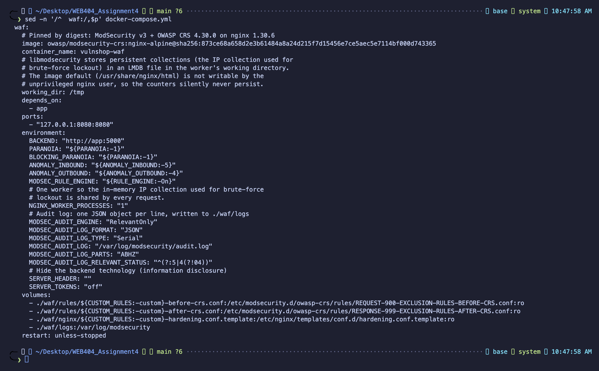

| Setting | Value | Why |
|---------|-------|-----|
| `BACKEND` | `http://app:5000` | nginx proxies everything to the app |
| `MODSEC_RULE_ENGINE` | `On` (configurable: `DetectionOnly`) | Actually block, not just log |
| `PARANOIA` / `BLOCKING_PARANOIA` | `1` (configurable 1–4) | PL1 is the recommended production start point; PL2 was also tested |
| `ANOMALY_INBOUND` / `ANOMALY_OUTBOUND` | `5` / `4` | CRS defaults: one critical match blocks |
| `MODSEC_AUDIT_LOG_FORMAT` | `JSON` | Machine-readable evidence of which rule fired |
| `MODSEC_AUDIT_ENGINE` | `RelevantOnly` | Log only 4xx/5xx and rule matches |
| `NGINX_WORKER_PROCESSES` | `1` | Brute-force counter is shared by all requests |
| `working_dir` | `/tmp` | Required for persistent collections (see §9.1) |
| `SERVER_HEADER` | empty | Do not advertise nginx |

The image includes custom rules through two hook files that CRS loads automatically:
`REQUEST-900-EXCLUSION-RULES-BEFORE-CRS.conf` and `RESPONSE-999-EXCLUSION-RULES-AFTER-CRS.conf`.
The `CUSTOM_RULES` variable swaps between `custom` and `none`, so the same stack can be tested with
and without the project's rules.

### 5.2 Custom rules

The full rule files are [waf/rules/custom-before-crs.conf](waf/rules/custom-before-crs.conf) and
[waf/rules/custom-after-crs.conf](waf/rules/custom-after-crs.conf). They use IDs 10000–19999 from
ModSecurity's local-use range and are grouped as follows.

**A. Brute-force protection (rules 10000, 10001, 10500).** A per-IP persistent collection is opened
in phase 1. In phase 3, every `401` from `/login` increments `ip.failed_logins` with a 60-second
expiry. Once the counter reaches 5, further `POST /login` requests from that IP get **HTTP 429**,
even with the correct password, until the counter expires.

```apache
SecRule REQUEST_FILENAME "@streq /login" "id:10500,phase:3,pass,log,chain,..."
    SecRule RESPONSE_STATUS "@streq 401" "setvar:ip.failed_logins=+1,expirevar:ip.failed_logins=60"
```

**B. Virtual patches: allowlist validation per endpoint (rules 10100–10180)**

| Rule | Endpoint | Allowed input | Stops |
|------|----------|---------------|-------|
| 10100 | `/login` | `username` matches `^[A-Za-z0-9_.@-]{1,64}$` | SQLi via username |
| 10110 | `/product` | `id` is digits only | Blind SQLi |
| 10120 | `/products` | `q` must not contain SQL comments, `;`, or quote + SQL keyword (plain apostrophes allowed) | UNION / error SQLi |
| 10130 | `/tools/ping` | `host` is a hostname or IPv4 address | Command injection |
| 10140 | `/docs` | `file` is a bare name ending `.txt`/`.md` | Traversal / LFI |
| 10150 | `/upload` | Filename `name.png|jpg|jpeg|gif|pdf`, one dot, no path | Dangerous extensions, double extensions, path in filename |
| 10151 | `/upload` | Body has no `<?php`, `<%`, `<script`, SVG event handlers or shebang | Script disguised as an image |
| 10152 | `/upload` | Total size ≤ 2 MB | Resource exhaustion |
| 10160 | `/fetch` | `url` is `https://` on an allowlisted domain | SSRF (descriptor 3.6.2) |
| 10170 | `/greet` | `name` is letters, digits, space, `.'-` | Reflected XSS |
| 10180 | `/report` | `year` is a 4-digit year | The input that causes the stack trace |

Example (command injection virtual patch):

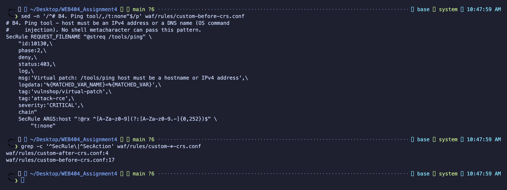

**C. Access control at the edge (rules 10200–10220).** `/internal/*` returns 404 from the WAF.
Sensitive files (`.env`, `.git`, `.bak`, `.sql`, `/backup/`) return 404. Only `GET`, `HEAD` and
`POST` are allowed.

**D. False-positive tuning (rule 10300).** At PL2 a normal English feedback message was blocked
(see §7.6). The exclusion removes **only** the `message` field, **only** on `/feedback`, and **only**
from the SQLi and RCE rule groups. Every other CRS rule still applies to it. This narrow, targeted
exclusion is better than disabling rules globally:

```apache
SecRule REQUEST_FILENAME "@streq /feedback" "id:10300,phase:1,pass,nolog,\
    ctl:ruleRemoveTargetByTag=attack-sqli;ARGS:message,\
    ctl:ruleRemoveTargetByTag=attack-rce;ARGS:message"
```

**E. Response rules (10510–10512)** detect Python stack traces, database errors and credentials
(`AKIA…` keys, `root:x:0:0:`) in response bodies. As explained in §9.3, with the nginx connector
these work for **detection and alerting** but cannot reliably block.

### 5.3 nginx hardening

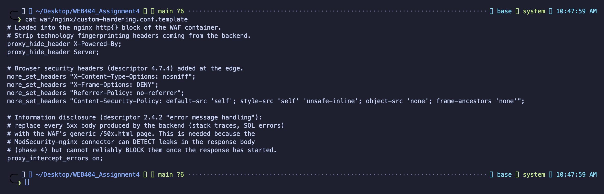

- `proxy_hide_header X-Powered-By` / `Server` removes technology fingerprints.
- `X-Content-Type-Options`, `X-Frame-Options`, `Referrer-Policy` and `Content-Security-Policy`
  add browser security headers (descriptor 4.7.4).
- `proxy_intercept_errors on` replaces every backend 5xx body with a generic error page, so SQL
  errors and stack traces never reach the client.

## 6. Testing methodology

1. **Baseline.** Each attack was first sent **directly** to the app (port 5001) to prove the
   vulnerability is real and exploitable.
2. **Same attack through the WAF** (port 8080) under four configurations:

   | Config | Rules | Paranoia |
   |--------|-------|----------|
   | CRS PL1 | CRS only (`CUSTOM_RULES=none`) | 1 |
   | CRS PL2 | CRS only | 2 |
   | Custom PL1 (**final**) | CRS + custom rules + nginx hardening | 1 |
   | Custom PL2 | CRS + custom rules + nginx hardening | 2 |

3. **Legitimate traffic** (9 normal requests) was sent under every configuration to measure
   **false positives**. A WAF that blocks real users is not usable.
4. **Evidence.** HTTP status codes were recorded with `curl`. The rule IDs that fired were read
   from the JSON audit log with [tools/waf_log.py](tools/waf_log.py). Screenshots were produced
   with [tools/render_screenshots.py](tools/render_screenshots.py), which runs each command for real.
5. **Tools:** curl, a browser, Docker Compose, the ModSecurity audit/debug logs, and the Nikto
   user-agent string (scanner detection).

Outcomes were classified as **Blocked** (403/404/405/413/429 from the WAF), **Allowed**
(request reached the app), or **Prevented** (request reached the app but the WAF stopped the
sensitive output from reaching the client).

## 7. Results

### 7.1 Baseline: the application is exploitable without a WAF

| SQLi login bypass | UNION SQLi dumps all passwords |
|---|---|
| 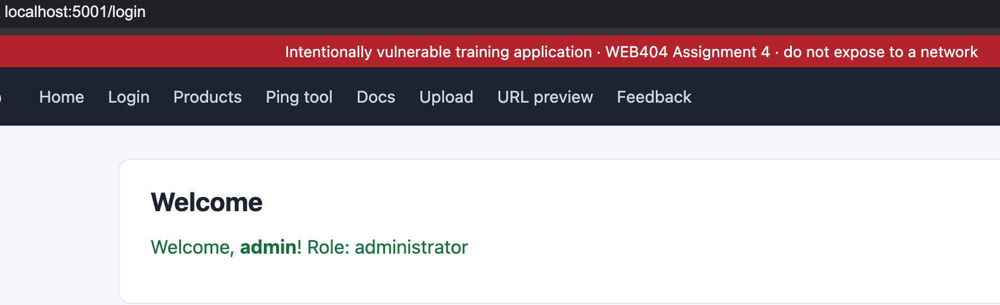 | 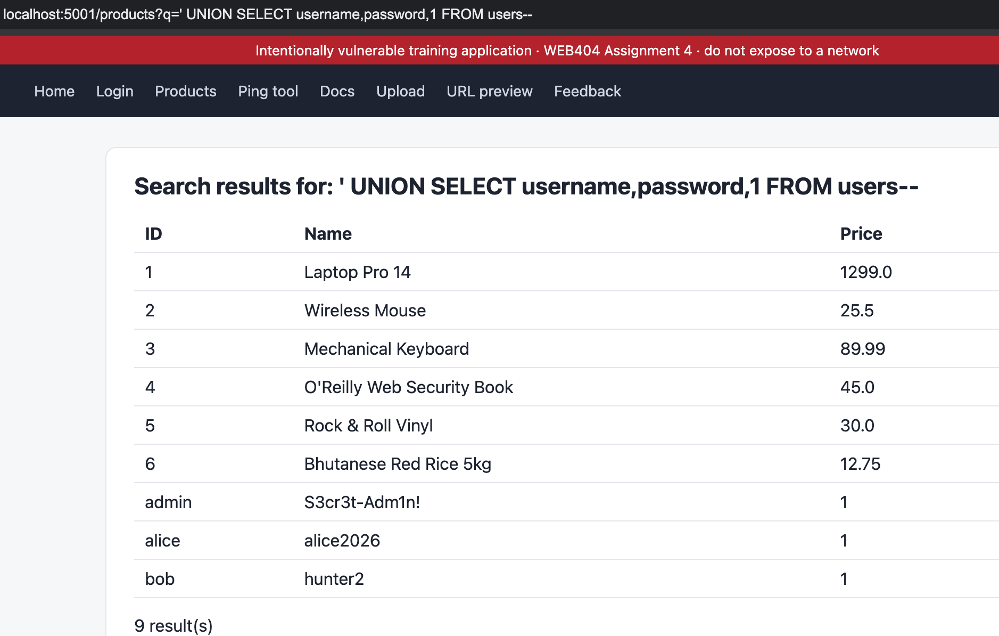 |

| Command injection runs as root | Directory traversal reads `/etc/passwd` |
|---|---|
| 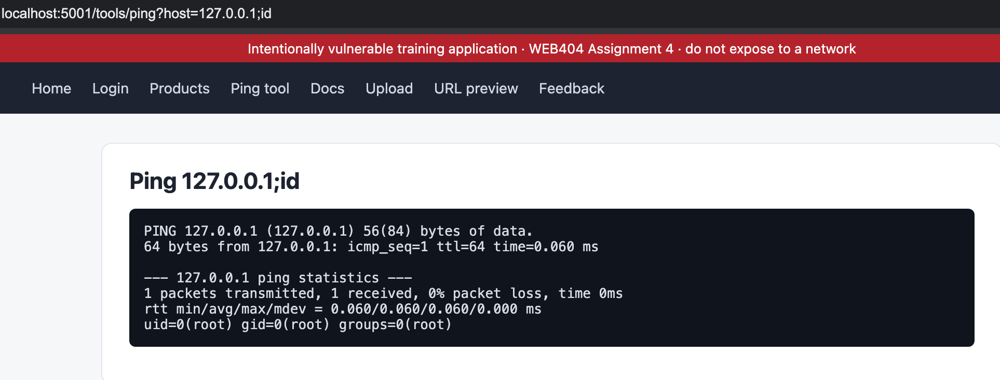 | 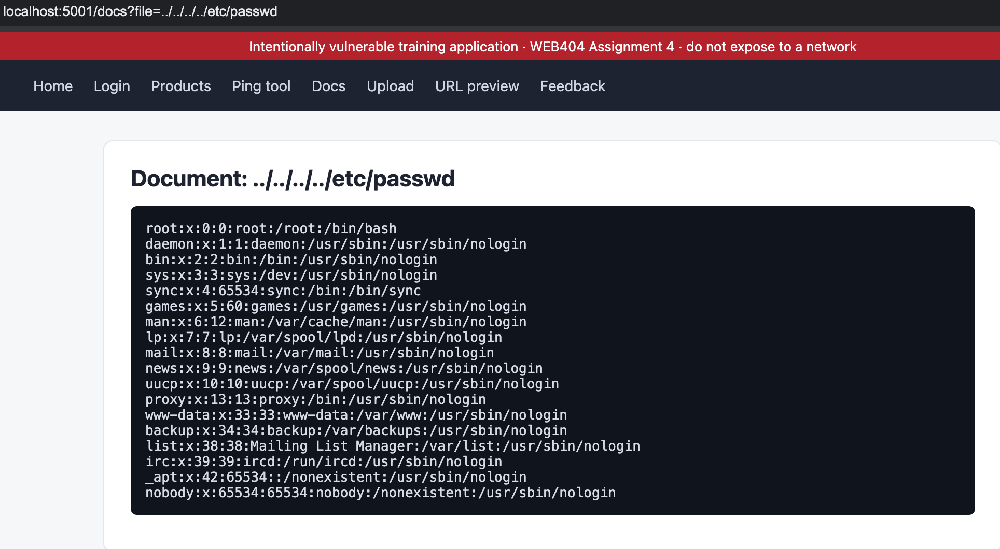 |

| SSRF reaches the internal admin panel | `.env` secrets exposed |
|---|---|
| 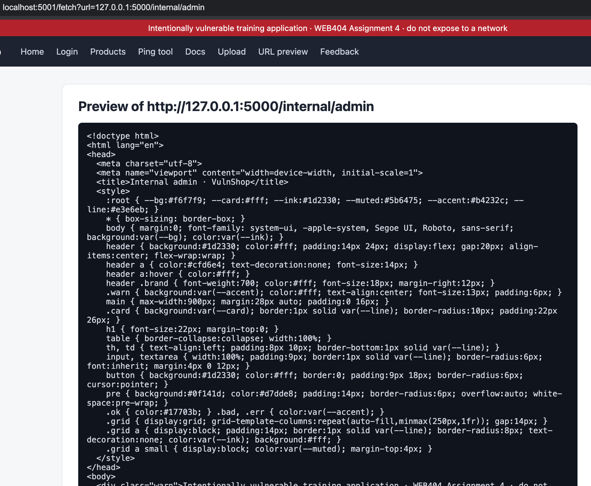 | 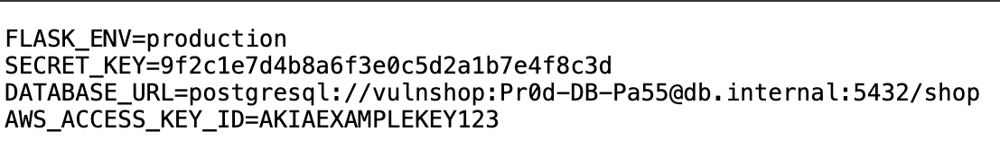 |

| Stack trace disclosure | PHP file accepted by the upload |
|---|---|
| 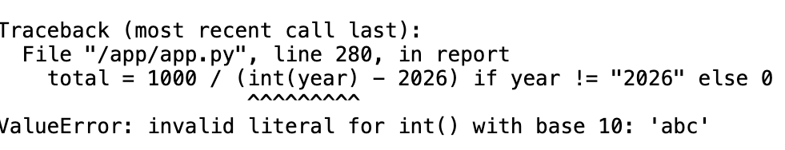 | 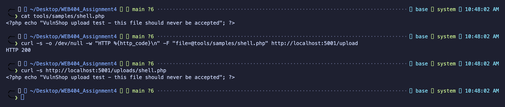 |

Fingerprinting headers (`Server: Werkzeug/…`, `X-Powered-By`):

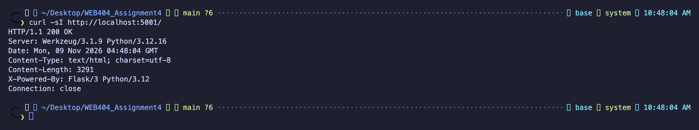

### 7.2 The same attacks through the WAF

| SQLi login bypass → 403 | UNION SQLi → 403 |
|---|---|
| 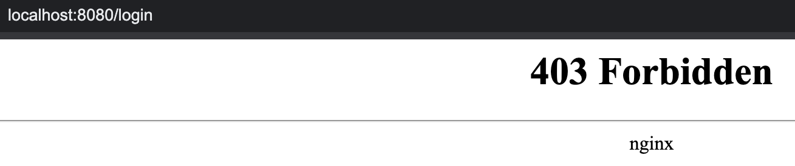 | 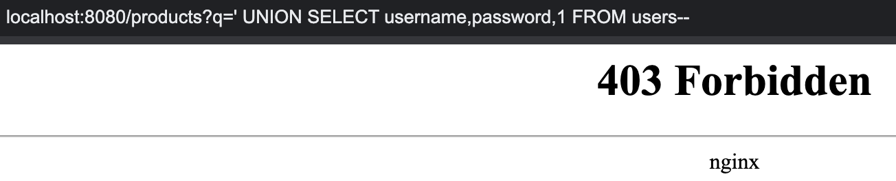 |

| Command injection → 403 | Directory traversal → 403 |
|---|---|
| 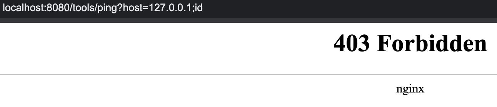 | 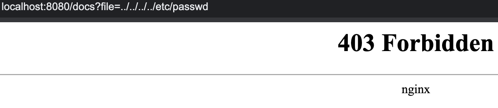 |

| SSRF → 403 | `.env` → 404 |
|---|---|
| 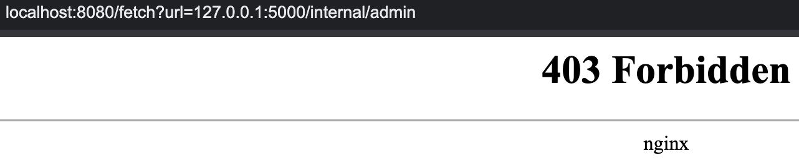 | 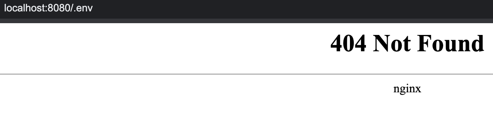 |

| Stack trace → 403 | Response headers hardened |
|---|---|
| 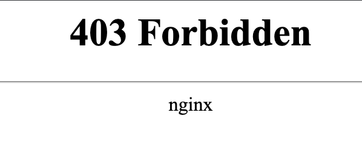 | 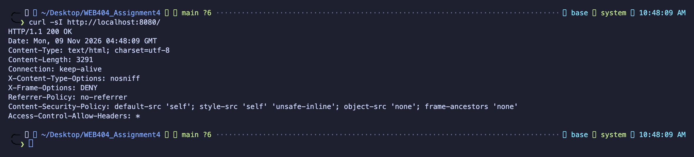 |

Malicious uploads are rejected: plain `.php`, double extension `shell.php.jpg`, and PHP code
renamed `photo.jpg` (caught by the content-inspection rule 10151):

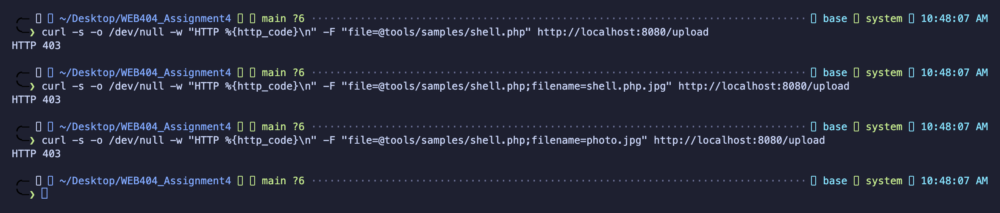

Summary of 11 requests, direct vs through the WAF:

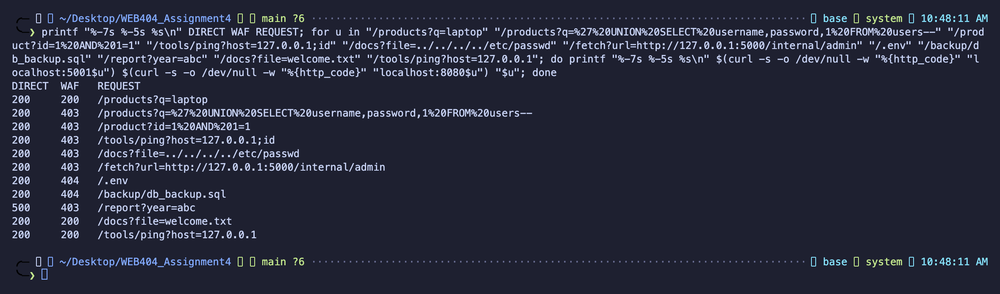

### 7.3 Full results matrix

HTTP status codes measured for every test under every configuration. ✅ = attack stopped,
❌ = attack succeeded / sensitive data reached the client.

| # | Test | Direct | CRS PL1 | CRS PL2 | **Custom PL1** | Custom PL2 |
|---|------|:------:|:-------:|:-------:|:--------------:|:----------:|
| 1 | SQLi UNION (`/products`) | 200 ❌ | 403 ✅ | 403 ✅ | **403 ✅** | 403 ✅ |
| 2 | SQLi boolean blind (`/product`) | 200 ❌ | 403 ✅ | 403 ✅ | **403 ✅** | 403 ✅ |
| 3 | SQLi login bypass (`admin'--`) | 200 ❌ | 403 ✅ | 403 ✅ | **403 ✅** | 403 ✅ |
| 4 | Command injection (`127.0.0.1;id`) | 200 ❌ | 200 ❌ | 200 ❌ | **403 ✅** | 403 ✅ |
| 5 | Traversal `../../../../etc/passwd` | 200 ❌ | 403 ✅ | 403 ✅ | **403 ✅** | 403 ✅ |
| 6 | Traversal absolute `/etc/passwd` | 200 ❌ | 403 ✅ | 403 ✅ | **403 ✅** | 403 ✅ |
| 7 | Upload `shell.php` | 200 ❌ | 403 ✅ | 403 ✅ | **403 ✅** | 403 ✅ |
| 8 | Upload `shell.php.jpg` | 200 ❌ | 200 ❌ | 200 ❌ | **403 ✅** | 403 ✅ |
| 9 | Upload PHP code named `photo.jpg` | 200 ❌ | 200 ❌ | 200 ❌ | **403 ✅** | 403 ✅ |
| 10 | SSRF to `127.0.0.1/internal/admin` | 200 ❌ | 403 ✅ | 403 ✅ | **403 ✅** | 403 ✅ |
| 11 | SSRF `file:///etc/passwd` | 200 ❌ | 403 ✅ | 403 ✅ | **403 ✅** | 403 ✅ |
| 12 | `/.env` | 200 ❌ | 403 ✅ | 403 ✅ | **404 ✅** | 404 ✅ |
| 13 | `/.git/config` | 200 ❌ | 403 ✅ | 403 ✅ | **404 ✅** | 404 ✅ |
| 14 | `/backup/db_backup.sql` | 200 ❌ | 403 ✅ | 403 ✅ | **404 ✅** | 404 ✅ |
| 15 | Stack trace (`/report?year=abc`) | 500 ❌ | 500 ❌ | 500 ❌ | **403 ✅** | 403 ✅ |
| 16 | SQL error message leak | 500 ❌ | 500 ❌ | 500 ❌ | **500 ✅¹** | conn. closed ✅² |
| 17 | Reflected XSS `<script>` | 200 ❌ | 403 ✅ | 403 ✅ | **403 ✅** | 403 ✅ |
| 18 | Nikto scanner user-agent | 200 ❌ | 403 ✅ | 403 ✅ | **403 ✅** | 403 ✅ |
| | **Attacks stopped** | **0 / 18** | **13 / 18** | **13 / 18** | **18 / 18** | **18 / 18** |
| 19 | Home page | 200 | 200 | 200 | 200 | 200 |
| 20 | Search `laptop` | 200 | 200 | 200 | 200 | 200 |
| 21 | Search `Rock & Roll` | 200 | 200 | 200 | 200 | 200 |
| 22 | Product `id=2` | 200 | 200 | 200 | 200 | 200 |
| 23 | Ping `127.0.0.1` | 200 | 200 | 200 | 200 | 200 |
| 24 | Docs `welcome.txt` | 200 | 200 | 200 | 200 | 200 |
| 25 | Upload real `product.png` | 200 | 200 | 200 | 200 | 200 |
| 26 | Login with correct password | 200 | 200 | 200 | 200 | 200 |
| 27 | Feedback in plain English | 200 | 200 | **403 ✗** | 200 | 200 |
| | **False positives** | – | **0 / 9** | **1 / 9** | **0 / 9** | **0 / 9** |

¹ The request reaches the app, but `proxy_intercept_errors` replaces the SQL error with a generic page (shot 35).
² CRS outbound rules fired in phase 4 after headers were sent, so nginx closed the connection. No data
leaked, but the user experience is poor (see §9.3).

### 7.4 Which rule stopped each attack (Custom PL1)

From the audit log of the final configuration. The custom rules are loaded before CRS, so for
known endpoints they block first, with a precise message:

| Test | Rule(s) | Message |
|------|---------|---------|
| SQLi UNION | 10120 | Virtual patch: SQL syntax in /products search term |
| SQLi blind | 10110 | Virtual patch: /product id must be numeric |
| SQLi login | 10100 | Virtual patch: /login username failed allow-list validation |
| Command injection | 10130 | Virtual patch: /tools/ping host must be a hostname or IPv4 address |
| Traversal (both) | 10140 | Virtual patch: /docs file must be a plain document name |
| Upload `.php`, double ext. | 10150 | File upload: file name or extension not allowed |
| PHP as `.jpg` | 10151 | File upload: active content detected inside uploaded file |
| SSRF (both) | 10160 | Virtual patch: /fetch URL is not on the allow-list (SSRF) |
| `.env`, `.git`, backup | 10210 | Access control: request for sensitive file or backup |
| Stack trace | 10180 | Virtual patch: /report year must be a 4 digit year |
| XSS | 10170 | Virtual patch: /greet name must be plain text |
| Nikto UA | 913100 → 949110 | CRS scanner detection, anomaly score exceeded |

With **CRS only**, the UNION attack was caught by four independent SQLi rules (942100 libinjection,
942190, 942270, 942360), giving an anomaly score of 20, four times the threshold:

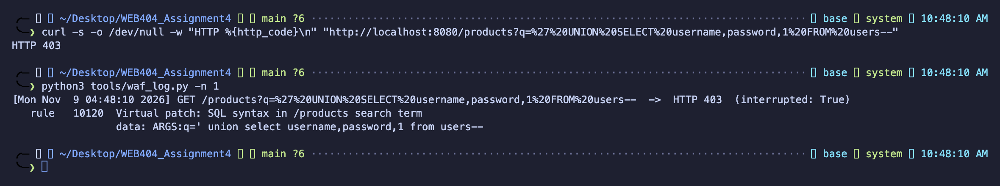
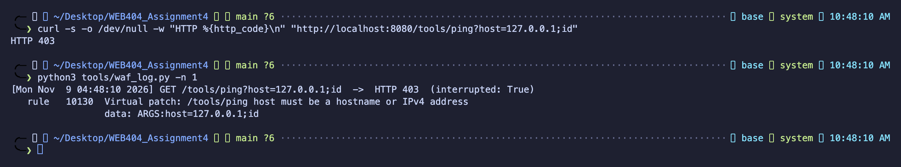
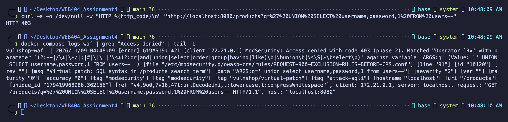

### 7.5 Brute-force protection

Five wrong passwords return `401`. The 6th and 7th attempts return **`429`**, and so does the
**correct** password while the lockout is active:

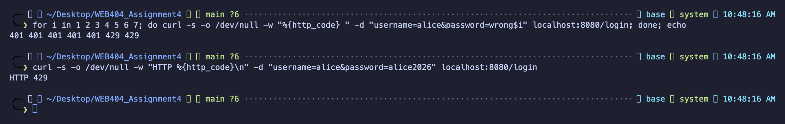
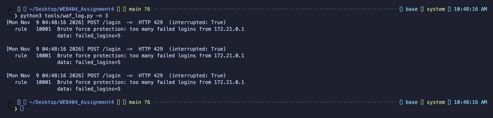

After 60 seconds the counter expires and the user can log in again:

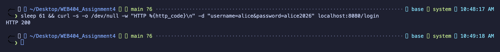

### 7.6 Information disclosure and error handling

A database error that leaks the SQL query directly (port 5001) is replaced by a generic page at the WAF:

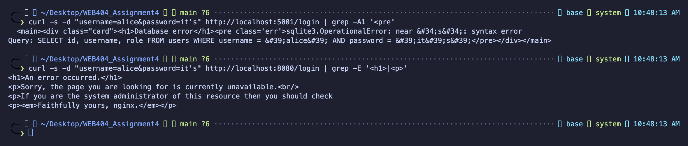

### 7.7 CRS alone vs CRS + custom rules

CRS has no rules for Python stack traces, so with CRS only the traceback, including the source
path and code line, passes straight through. The custom rule blocks it:

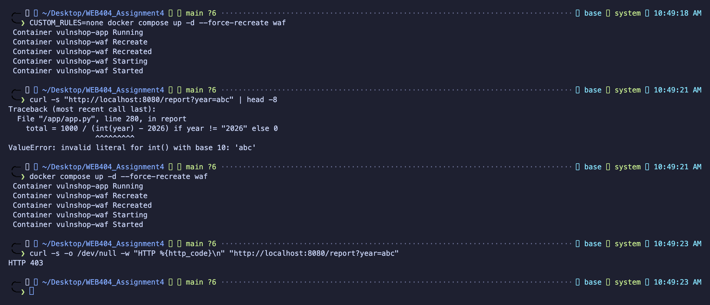

### 7.8 False positives at paranoia level 2 and tuning

At PL2, rule **942200** ("MySQL comment-/space-obfuscated injections") matched an ordinary customer
message containing "select … ; I'd like … update … from". Exclusion rule 10300 fixed it without
weakening the rest of the WAF:

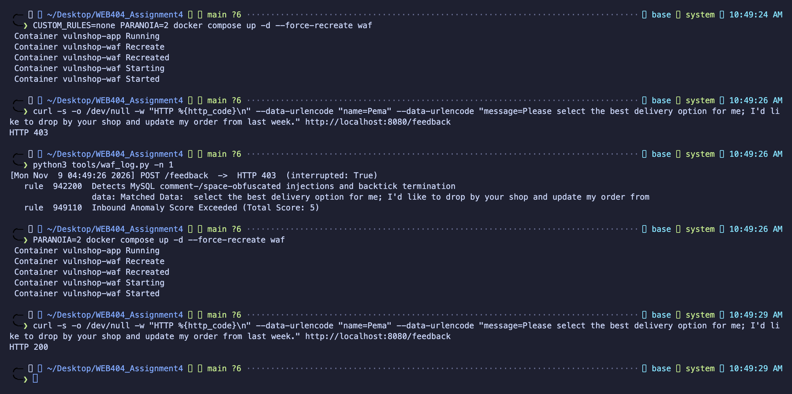

### 7.9 Detection-only mode

With `RULE_ENGINE=DetectionOnly` the attack reaches the app (200), but every rule that would have
blocked it is logged (`interrupted: False`). This is the recommended way to introduce a WAF into
production safely: observe, tune false positives, then switch to blocking.

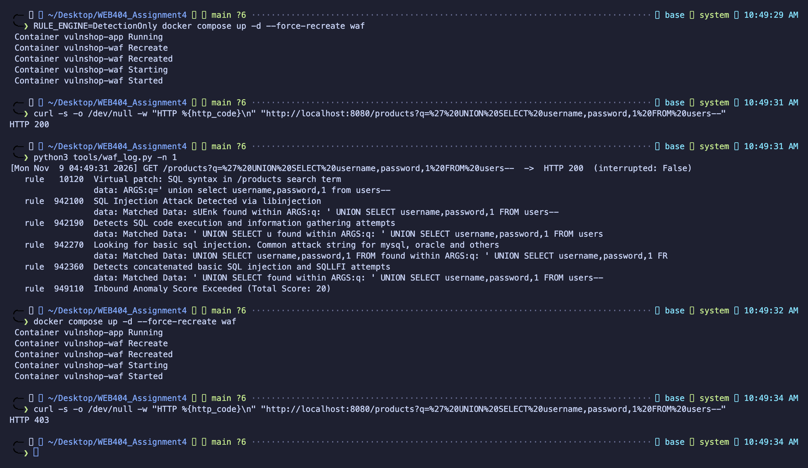

### 7.10 Legitimate traffic is unaffected

| Normal search | Search with special characters |
|---|---|
| 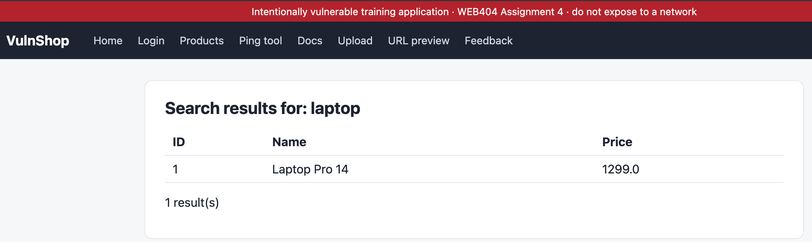 | 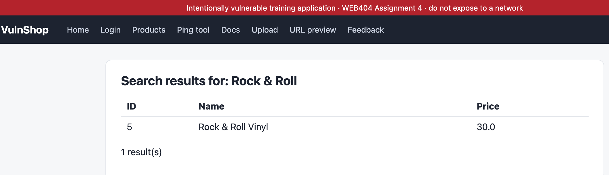 |

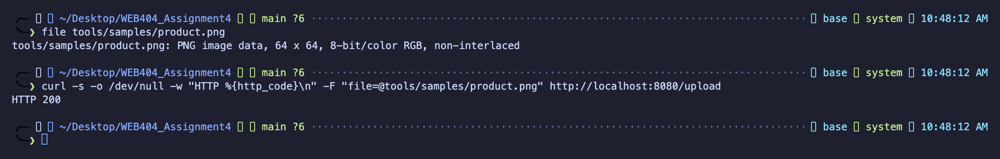

## 8. Analysis: how effective was the WAF?

**1. CRS alone is a strong baseline but not complete.** Out of the box, PL1 stopped 13 of 18
attacks with zero false positives. It reliably detected well-known syntax: SQL keywords, `../`
sequences, `<script>`, restricted files, scanner user-agents and SSRF to loopback.

**2. What CRS missed, and why**

| Missed attack | Reason |
|---------------|--------|
| `127.0.0.1;id` command injection (PL1 **and** PL2) | The payload is very short and `id` is also an ordinary English word. Generic signatures must avoid matching common words, so a short command did not reach the anomaly threshold. |
| `shell.php.jpg` upload | CRS checks the *final* extension; `.jpg` is harmless. |
| PHP code inside `photo.jpg` | CRS does not inspect uploaded file contents by default. |
| Python stack trace | CRS data-leakage rules cover SQL, Java, PHP, IIS and Ruby errors, but not Python. |
| SQL error leak | Response inspection could not stop a body that was already streaming (§9.3). |

Raising the paranoia level to PL2 **did not catch any extra attack** in this test set, but it
**introduced a false positive**. Increasing paranoia is not a free improvement.

**3. Application-specific rules closed every gap.** Adding 21 custom rules raised the result to
**18 / 18 stopped with 0 false positives** at both PL1 and PL2. Allowlist (positive-model) rules
are much stronger than signatures for known parameters. For example, rule 10130 allows only
hostname characters in `host`, so no command-injection payload of any form can pass. Signatures
can only guess which payloads are dangerous.

**4. Trade-offs.** Positive rules must be maintained. Every new parameter, or change to valid
input (for example a new upload type), needs a rule update, or legitimate users will be blocked.
They are best used for high-risk endpoints, with CRS as the generic safety net everywhere else.

## 9. Problems encountered and how they were solved

### 9.1 Brute-force counter never increased (persistent storage)

The failed-login counter was set to `1` on every request and never reached 5. The ModSecurity debug
log (level 9) showed `Saving variable: IP:failed_logins with value: 1` each time. libmodsecurity in
this image is built with **LMDB** and stores persistent collections in a file in the nginx worker's
working directory. That directory (`/usr/share/nginx/html`) is not writable by the unprivileged nginx
user, so the save failed **silently**. **Fix:** `working_dir: /tmp` in `docker-compose.yml`.
The file `modsec-shared-collections` then appeared:

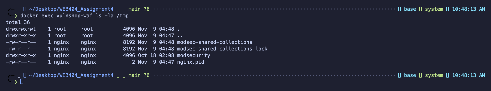

### 9.2 Collection variable names are case-sensitive

Once the counter persisted (the audit log showed 4, 5, 6, 7 …), the lockout still did not trigger.
The rule read `IP:FAILED_LOGINS` (uppercase, as in most ModSecurity v2 examples), but the LMDB
backend in v3 stores keys exactly as written by `setvar` (`failed_logins`). **Fix:** read
`IP:failed_logins`.

### 9.3 Response-body (phase 4) blocking is not reliable with nginx

Rule 10511 correctly **detected** the leaked SQL error in the response body, but the full page still
reached the client. Enabling `proxy_buffering` did not help. With the ModSecurity-nginx connector
the response headers are already sent when phase 4 runs, so the status cannot be changed. At PL2,
CRS's own outbound rules hit the same problem: nginx logged `header already sent` and closed the
connection, leaving the client with an empty reply.

**Fix / design decision:**
- Treat phase-4 rules as **detection and alerting**.
- Prevent leaks with `proxy_intercept_errors` (generic 5xx pages).
- Most importantly, block the **input** that causes the error in phase 2 (e.g. rule 10180).

## 10. Limitations and recommendations

A WAF is a **compensating control**. It reduces risk while vulnerable code exists, but it does not
remove the vulnerability. Anyone who reaches the app without going through the WAF (port 5001 in
this lab, or an internal attacker) can still exploit every flaw. Signature rules can also be
bypassed by payloads their authors did not anticipate.

**Fix the code (defence in depth).** Each vulnerability should be fixed at its source:

| Vulnerability | Secure coding fix |
|---------------|-------------------|
| SQL injection | Parameterised queries: `db.execute("SELECT … WHERE username = ? AND password = ?", (u, p))` |
| Command injection | No shell: validate with `ipaddress.ip_address()` and call `subprocess.run(["ping", "-c", "1", host])` |
| Directory traversal | `p = os.path.realpath(os.path.join(BASE, name))`, then reject unless `p.startswith(BASE + os.sep)` |
| File upload | Extension *and* magic-byte allowlist, random server-side filenames (`uuid4()`), store outside the web root, serve with `Content-Disposition: attachment` |
| SSRF | Allowlist of hosts in code, resolve DNS and block private/loopback ranges, allow `https` only |
| Information disclosure | Generic error handlers, log details server-side only; remove secrets and backups from the web root |
| Brute force | Rate limiting and account lockout in the application, MFA |
| Passwords | Hash with bcrypt/Argon2 instead of storing plain text |

**Operating the WAF**

1. Deploy in **DetectionOnly** first, review the audit log, and tune exclusions **narrowly**
   (per URL, per parameter, per rule tag), as in rule 10300.
2. Start at **PL1**. Raise the paranoia level only for sensitive applications, and budget for the
   extra tuning work.
3. Make sure the application is **only reachable through the WAF** (firewall the backend).
4. Keep CRS updated, monitor the audit log (e.g. ship it to a SIEM), and alert on repeated blocks.
5. Do not rely on response-body blocking with the nginx connector. Prevent leaks at the source.

## 11. Conclusion

A ModSecurity v3 WAF with OWASP CRS 4.30 was configured in front of a deliberately vulnerable Flask
application and tested against 18 server-side attacks and 9 legitimate requests.

- **CRS alone (PL1)** stopped 13 of 18 attacks with no false positives.
- **PL2** caught nothing extra and blocked one legitimate request.
- **Adding 21 application-specific rules** (virtual patches, upload validation, SSRF allowlist,
  edge access control, brute-force lockout) plus nginx hardening stopped **all 18 attacks** with
  **no false positives**.

The practical also exposed real operational issues: silent persistence failures, case-sensitive
collection keys, and unreliable response-body blocking. These show that a WAF must be tested, not
just switched on. A well-configured WAF is an effective extra layer of defence, but it complements
secure coding practices rather than replacing them.

## 12. How to reproduce

```bash
# start the lab (app on :5001 unprotected, WAF on :8080)
docker compose up -d --build

# switch WAF configuration
CUSTOM_RULES=none docker compose up -d --force-recreate waf          # CRS only
PARANOIA=2 docker compose up -d --force-recreate waf                 # paranoia level 2
RULE_ENGINE=DetectionOnly docker compose up -d --force-recreate waf  # log only
docker compose up -d --force-recreate waf                            # back to final config

# see which rules fired for the last 3 requests
python3 tools/waf_log.py -n 3

# regenerate every screenshot in screenshots/
python3 tools/render_screenshots.py

# stop everything
docker compose down
```

Each screenshot's commands are defined in the `SHOTS` list in
[tools/render_screenshots.py](tools/render_screenshots.py); re-render a single one with e.g.
`python3 tools/render_screenshots.py 32`.

## 13. References

- Hoffman, A. (2024). *Web Application Security: Exploitation and Countermeasures for Modern Web Applications* (2nd ed.). O'Reilly.
- McDonald, M. (2020). *Web Security for Developers: Real Threats, Practical Defense*. No Starch Press.
- Stuttard, D., & Pinto, M. (2011). *The Web Application Hacker's Handbook: Finding and Exploiting Security Flaws* (2nd ed.). John Wiley & Sons.
- OWASP Core Rule Set documentation. https://coreruleset.org/docs/
- ModSecurity Reference Manual (v3). https://github.com/owasp-modsecurity/ModSecurity/wiki
- OWASP CRS Docker image. https://github.com/coreruleset/modsecurity-crs-docker
- OWASP Top 10 (2021). https://owasp.org/Top10/
